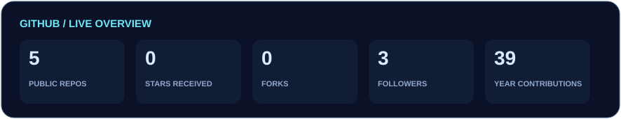
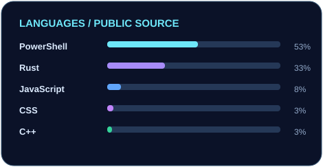
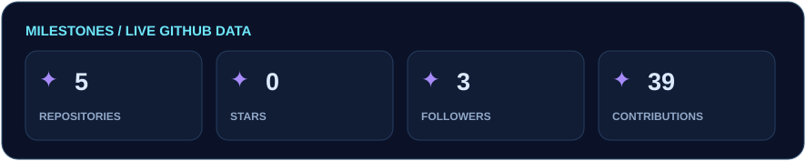
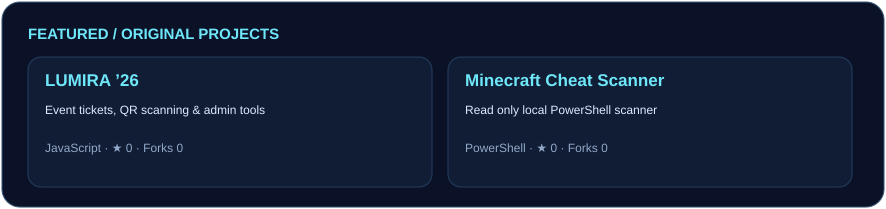
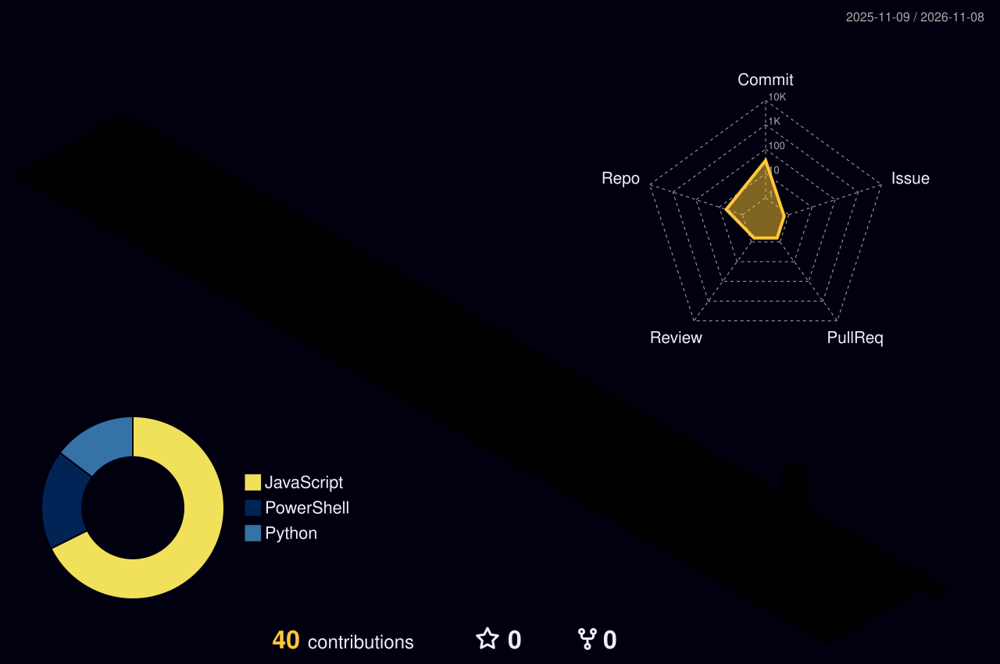
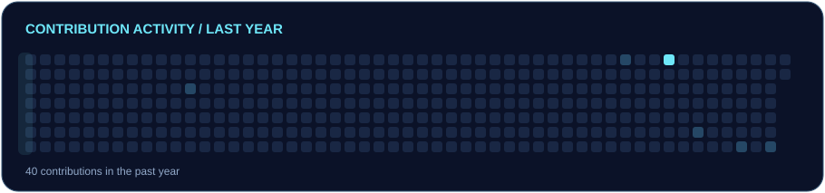

 

 

## About me

I'm **Gamitha**, a developer making interactive web experiences and practical local tools. My public work includes an event ticketing and QR scanning app built with JavaScript and Firebase, and a read only PowerShell scanner for Minecraft Java installations.

WEB EXPERIENCES &nbsp; · &nbsp; AUTOMATION &nbsp; · &nbsp; PRACTICAL TOOLS

## Tech stack

These technologies appear in my public repositories:

| Area | Evidence |
| :-- | :-- |
| Web interfaces | JavaScript, HTML, and CSS in [LUMIRA ’26](https://github.com/Mr-Gamiya/school) |
| Data and backend | Firebase Firestore and Cloud Functions in [LUMIRA ’26](https://github.com/Mr-Gamiya/school) |
| Local automation | PowerShell in [Minecraft Cheat Scanner](https://github.com/Mr-Gamiya/MC-Cheat-detector) |

## GitHub dashboard

 

## Contribution streak

## GitHub trophies

## Featured projects

| Project | What it does | Main language |
| :-- | :-- | :-- |
| [LUMIRA ’26](https://github.com/Mr-Gamiya/school) | Event registration, QR tickets, an admin dashboard, and scanning | JavaScript |
| [Minecraft Cheat Scanner](https://github.com/Mr-Gamiya/MC-Cheat-detector) | Local, read only Minecraft Java installation and runtime checks | PowerShell |

I also [explore the Clicky project in a fork](https://github.com/Mr-Gamiya/clicky); the original project is by [farzaa](https://github.com/farzaa/clicky).

## 3D contribution graph

If the graphic is unavailable, [view my contribution history on GitHub](https://github.com/Mr-Gamiya?tab=overview).

## Activity graph

## Contribution snake

If the animation is unavailable, [see the contribution graph on my profile](https://github.com/Mr-Gamiya?tab=overview).

## Connect

  

